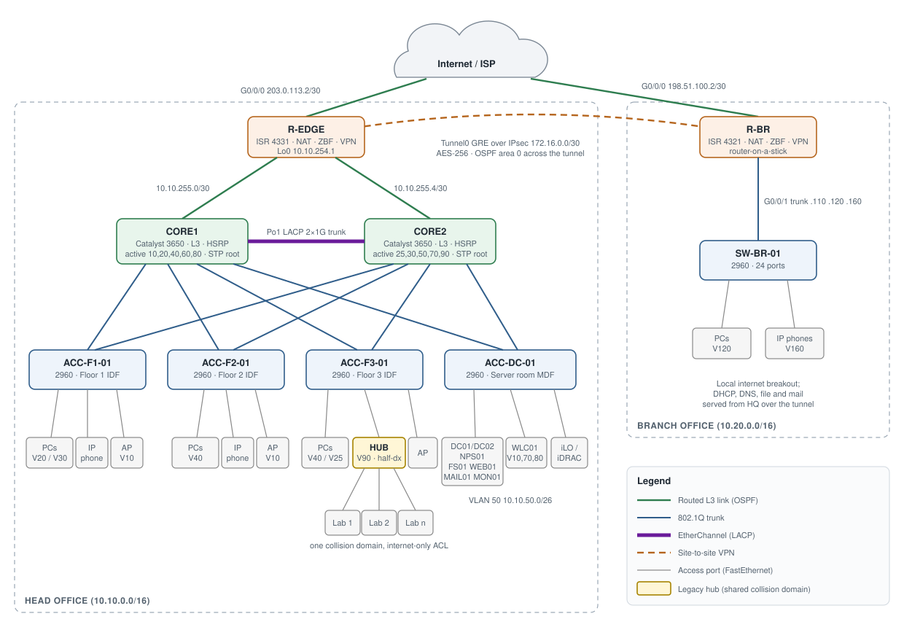
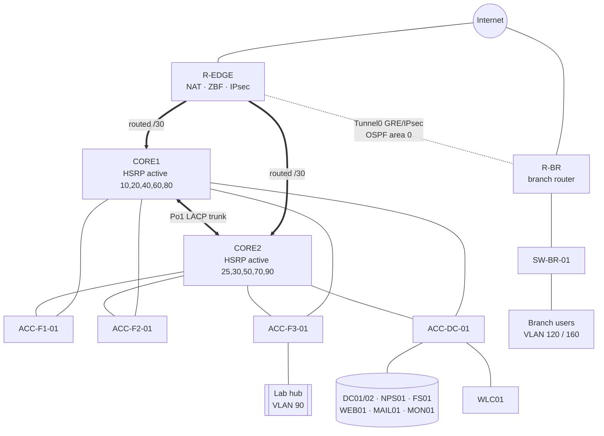
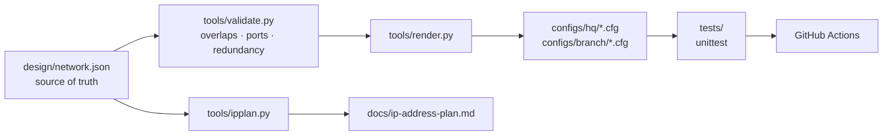

# Network Design for an IT Company

**Enterprise LAN/WAN design for a fictional 145-person IT consulting company: a head office on three floors and a branch office.**
It covers both the physical layout (hubs, switches, routers, cabling, racks) and the logical design (VLANs, IP plan, routing, redundancy, security, wireless and voice).

> **Provenance.** This was my academic network design project in the Computer Systems Technician
> (Network Systems) diploma at Mohawk College, 2021. It was built and tested in Cisco Packet Tracer.
> In 2026 I rewrote the documentation for this portfolio and added a source-of-truth file, a config
> generator, a validator and tests, so the design can be checked and rebuilt automatically. The company
> is fictional, and all addresses are private (RFC 1918) or documentation (RFC 5737) ranges.



## At a glance

| | |
|---|---|
| **Sites** | HQ (3 floors, about 120 staff, server room) and branch (about 25 staff) |
| **Architecture** | Collapsed core: two Layer 3 core switches, four Layer 2 access switches, each one dual-homed to both cores |
| **Redundancy** | HSRPv2 gateways split across both cores, Rapid-PVST+ root matched to each HSRP active core, LACP EtherChannel core interlink, uplink tracking |
| **Segmentation** | 10 VLANs at HQ and 3 at the branch, sized with VLSM. Unused ports sit in a blackhole VLAN 999 that is never routed |
| **Routing** | OSPF area 0 across HQ and over the VPN tunnel. The edge router sends a default route into OSPF |
| **WAN** | GRE over IPsec (IKEv1, AES-256, SHA-256, DH group 14, PFS) between HQ and branch. The branch uses its own internet connection |
| **Edge security** | NAT/PAT, an IOS zone-based firewall, and only inbound SMTP published (to the mail server) |
| **Access security** | Port security, DHCP snooping, Dynamic ARP Inspection, BPDU guard, RADIUS (NPS) logins, SSH only, SNMPv3, management ACLs |
| **Wireless** | Cisco 2504 WLC with lightweight APs. Two SSIDs: CORP on WPA2-Enterprise (VLAN 70) and GUEST, internet only (VLAN 80) |
| **Voice** | Voice VLAN 60 with QoS trust tied to Cisco phones |
| **Hubs** | A legacy hub serves the training lab on its own internet-only VLAN, forced to half duplex. The reason is in [docs/09](docs/09-hubs-vs-switches.md) |

## Logical view



## VLANs

| VLAN | Name | Subnet | Gateway | Notes |
|---:|---|---|---|---|
| 10 | MGMT | 10.10.10.0/24 | .1 (HSRP) | Infrastructure management. Only IT-OPS can reach it |
| 20 | ADMIN-HR | 10.10.20.0/24 | .1 | |
| 25 | IT-OPS | 10.10.25.0/26 | .1 | Admin workstations |
| 30 | SALES | 10.10.30.0/24 | .1 | |
| 40 | ENGINEERING | 10.10.40.0/23 | .1 | Largest group |
| 50 | SERVERS | 10.10.50.0/26 | .1 | Static addressing |
| 60 | VOICE | 10.10.60.0/24 | .1 | |
| 70 | WIFI-CORP | 10.10.70.0/23 | .1 | WPA2-Enterprise via NPS |
| 80 | WIFI-GUEST | 10.10.80.0/24 | .1 | Internet only |
| 90 | LAB-HUB | 10.10.90.0/27 | .1 | Behind the hub, internet only |
| 110/120/160 | Branch MGMT/STAFF/VOICE | 10.20.{10,20,60}.0/24 | .1 (R-BR) | Router-on-a-stick |

Full plan with DHCP scopes and every infrastructure address: [docs/ip-address-plan.md](docs/ip-address-plan.md).

## Documentation

| # | Document | What it covers |
|---|---|---|
| 01 | [Requirements](docs/01-requirements.md) | Business scenario, user counts, functional and non-functional requirements, constraints |
| 02 | [Architecture](docs/02-architecture.md) | Topology choice, redundancy model, STP/HSRP alignment, OSPF, traffic flows, failure scenarios |
| 03 | [Physical design](docs/03-physical-design.md) | Floor plan, MDF/IDF, rack elevations, structured cabling, port maps, power |
| -- | [IP address plan](docs/ip-address-plan.md) | Generated from the source of truth |
| 04 | [Security design](docs/04-security-design.md) | Defence in depth from the edge firewall down to the access port |
| 05 | [Wireless and voice](docs/05-wireless-and-voice.md) | WLC/AP design, SSIDs, RF plan, voice VLAN and QoS |
| 06 | [Implementation plan](docs/06-implementation-plan.md) | Build order, staging, cutover, rollback |
| 07 | [Test plan](docs/07-test-plan.md) | 30+ verification tests with commands and expected results |
| 08 | [Bill of materials](docs/08-bill-of-materials.md) | Hardware, licensing, cabling, cost estimate (2021) |
| 09 | [Hubs vs switches](docs/09-hubs-vs-switches.md) | Collision and broadcast domains, and why the lab hub is isolated |
| 10 | [Operations runbook](docs/10-operations-runbook.md) | Day-2 tasks, troubleshooting, backups, monitoring |
| 11 | [Design decisions](docs/11-design-decisions.md) | ADR-style record of the main trade-offs |
| 12 | [Packet Tracer build guide](docs/12-packet-tracer-build.md) | How to rebuild the lab in Cisco Packet Tracer |

## How the configs are built



```bash
python3 tools/validate.py          # check the design (addressing, VLANs, ports, redundancy)
python3 tools/render.py            # regenerate all 9 device configs
python3 tools/ipplan.py            # regenerate the IP plan document
python3 -m unittest discover -s tests -v
```

Only the Python 3.9+ standard library is needed. CI runs the same steps and fails if any committed config or document no longer matches the design.

## Repository layout

```
design/network.json        Source of truth: sites, VLANs, subnets, devices, ports, services
tools/render.py            Renders Cisco IOS/IOS-XE configs (no secrets: CHANGE_ME placeholders)
tools/validate.py          Design checks: overlaps, containment, duplicate IPs, port allocation, dual-homing
tools/ipplan.py            Generates the IP address plan document
configs/hq/                R-EDGE, CORE1, CORE2, ACC-F1-01, ACC-F2-01, ACC-F3-01, ACC-DC-01
configs/branch/            R-BR, SW-BR-01
diagrams/topology.svg      Physical/logical topology
docs/                      Design documentation (01-12)
tests/                     Unit tests for the validator and the rendered configs
```

## Skills shown

Network requirements analysis · hierarchical LAN design · VLSM subnetting · VLANs and 802.1Q trunking · Rapid-PVST+ · HSRP · EtherChannel (LACP) · OSPF · NAT/PAT · GRE over IPsec · zone-based firewall · port security, DHCP snooping, DAI · AAA with RADIUS · SNMPv3/syslog/NTP · wireless (WLC, CAPWAP, WPA2-Enterprise) · voice VLAN and QoS · structured cabling · test planning · infrastructure as code
