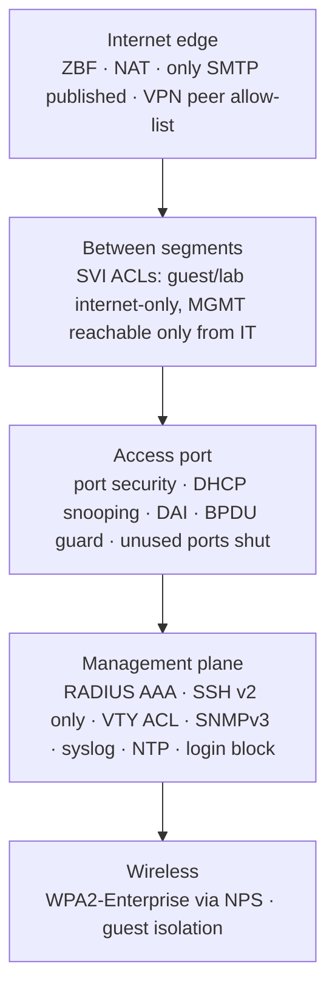

# 04 · Security Design

Security is layered from the internet edge down to the individual switch port, so no single control has to
be perfect.

## 1. Internet edge (R-EDGE, R-BR)

**Zone-based policy firewall (ZBF)**

| Zone pair | Policy | Allowed |
|---|---|---|
| INSIDE → OUTSIDE | `PM-INSIDE-TO-OUT` | TCP, UDP, ICMP, inspected statefully so return traffic is allowed automatically |
| OUTSIDE → INSIDE (HQ only) | `PM-OUT-TO-IN` | TCP/25 to MAIL01 only; everything else is dropped and logged |
| OUTSIDE → self | `PM-OUT-TO-SELF` | IKE (UDP 500/4500) and ESP **from the VPN peer's address only** |
| INSIDE ↔ INSIDE | (same zone) | The tunnel and LAN interfaces are both INSIDE, so branch↔HQ traffic flows freely after it is decrypted |

**Interface hardening on the outside interface**: `no ip redirects`, `no ip unreachables`, `no ip proxy-arp`,
`no cdp enable`. This stops the router from leaking topology or answering reconnaissance.

**NAT**: PAT overload for all internal users. One static PAT (TCP/25 → MAIL01) is the only published service.
Webmail and IMAP are **not** published, so remote users connect over VPN.

## 2. Segmentation between VLANs

| ACL | Applied | Effect |
|---|---|---|
| `INTERNET-ONLY-IN` | Inbound on SVI 80 (guest) and 90 (lab) | DHCP to the two DHCP servers is permitted first, then any RFC 1918 destination is denied (logged), then the internet is allowed |
| `MGMT-PROTECT-OUT` | Outbound on SVI 10 (traffic entering the management VLAN) | Only IT-OPS, the management VLAN itself, the server VLAN (monitoring, RADIUS, DHCP) and branch management may reach infrastructure addresses |
| `VTY-ALLOWED` | `line vty` on every device | SSH only from IT-OPS and the management VLAN |
| `SNMP-ALLOWED` | SNMP group | Only MON01 may poll |

Guests get public DNS resolvers from their DHCP scope, so they never need to reach an internal server.

## 3. Access-port protection (every access switch)

| Control | Configuration | Stops |
|---|---|---|
| Port security | `maximum 3` (PC + phone + phone's voice MAC) or 1 for APs, `sticky`, `violation restrict` | MAC flooding, unauthorised switches or hubs on desk ports |
| DHCP snooping | Enabled on client VLANs, uplinks `trust`, desk ports rate-limited to 15 pps | Rogue DHCP servers, DHCP starvation |
| Dynamic ARP Inspection | Same VLANs, uplinks `trust` | ARP spoofing / man-in-the-middle |
| BPDU guard | `spanning-tree portfast bpduguard default` | Someone plugging in a switch and changing the STP topology |
| Auto-recovery | `errdisable recovery ... interval 300` | Ports stay down for 5 minutes, which stops a loop without needing a technician visit for a mistake |
| Trunk hardening | `switchport nonegotiate`, explicit allowed VLAN lists, native VLAN 999 | DTP trunk negotiation attacks, VLAN hopping (double tagging) |
| Unused ports | Shut down and placed in VLAN 999 | Walk-up access from an empty wall jack |
| VLAN 1 | SVI shut, not used for anything | Default-VLAN attacks |

**Option 82 note**: `no ip dhcp snooping information option` is set because the access switch would otherwise
insert option 82 with a zero giaddr, and the Windows DHCP server would drop those requests. This is a
common real-world fix.

**Hub port**: the lab hub port allows up to 12 MACs, because every lab PC behind the hub shares that one
port. That is acceptable only because VLAN 90 is internet-only.

## 4. Management plane

| Control | Detail |
|---|---|
| AAA | `aaa new-model`; logins authenticate against NPS01 by RADIUS, with the local `netadmin` account as fallback if RADIUS is unreachable |
| Accounting | Exec start/stop records sent to RADIUS, so there is a record of who logged in and when |
| SSH | Version 2 only, 60 s timeout, 3 retries, RSA 2048-bit keys; telnet is not enabled anywhere (a unit test enforces this) |
| Brute force | `login block-for 120 attempts 5 within 60` |
| Secrets | `scrypt` hashing (type 9); the repository has only `CHANGE_ME` placeholders (a unit test enforces this) |
| Logging | Syslog at informational level to MON01, local buffer, timestamps with milliseconds and timezone |
| Time | NTP from MON01 so logs from all devices line up during an investigation |
| SNMP | v3 with authPriv (SHA + AES-128), read-only view, restricted by ACL; no v1/v2c communities |
| Banner | Legal warning banner on every device |

## 5. Wireless

- **CORP SSID**: WPA2-Enterprise (802.1X/PEAP-MSCHAPv2) against NPS01, which checks AD group membership. No
  shared password exists to leak.
- **GUEST SSID**: WPA2-PSK rotated monthly, client isolation on the WLC, mapped to VLAN 80, which is
  internet-only at the core ACL.
- APs only join WLC01 (management VLAN, CAPWAP DTLS-encrypted control channel).

## 6. Threats and mitigations

| Threat | Mitigation |
|---|---|
| Guest scans internal servers | Core ACL on VLAN 80 + WLC client isolation |
| Rogue DHCP server on a desk | DHCP snooping drops server messages on untrusted ports |
| ARP poisoning in Engineering | DAI validates ARP against snooping bindings |
| Someone plugs in a home router | BPDU guard + port security + DHCP snooping |
| Compromised PC tries to SSH to switches | MGMT-PROTECT-OUT + VTY-ALLOWED + RADIUS logins |
| Internet attacker | Only TCP/25 to one host is reachable; ZBF drops everything else |
| VPN sniffing over the internet | AES-256 ESP, PFS |
| Lab PCs (unmanaged, shared) infect others | VLAN 90 cannot reach any internal subnet |
