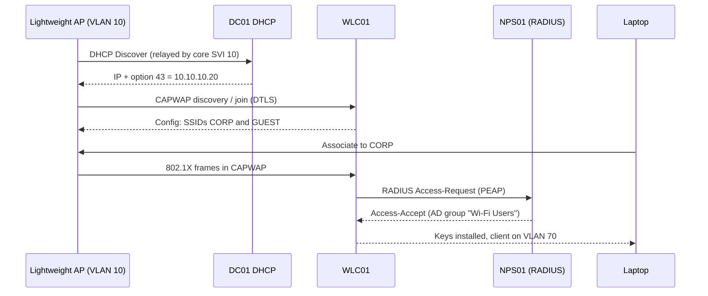

# 05 · Wireless and Voice

## Wireless architecture

| Component | Choice | Reason |
|---|---|---|
| Controller | Cisco 2504 WLC (WLC01, 10.10.10.20) | Central config, RF management and client roaming across 6 APs; supported in Packet Tracer |
| APs | Lightweight APs (2 per floor, 6 total), local mode | APs build a CAPWAP tunnel to the WLC, so no per-AP configuration is needed |
| AP addressing | DHCP in VLAN 10, with **option 43** pointing at the WLC | Zero-touch AP join |
| WLC uplink | 802.1Q trunk on ACC-DC-01 Fa0/13 carrying VLANs 10, 70, 80 | The WLC places each SSID's clients onto the right VLAN |

## SSIDs

| SSID | Security | VLAN | Subnet | Policy |
|---|---|---|---|---|
| NB-CORP | WPA2-Enterprise, AES-CCMP, PEAP-MSCHAPv2 via NPS01 | 70 | 10.10.70.0/23 | Full internal access as a normal user |
| NB-GUEST | WPA2-PSK (rotated monthly), client isolation, 5 Mb/s per-client rate limit | 80 | 10.10.80.0/24 | Internet only (core ACL) |

## RF plan

- **5 GHz preferred** (band select on). 2.4 GHz uses only the non-overlapping channels **1, 6, 11**.
- 5 GHz on 20/40 MHz channels from UNII-1/UNII-3 to avoid DFS radar events in an office near an airport flight path.
- APs on alternate floors are offset horizontally so the same channel is not stacked vertically.
- Design target: -67 dBm or better everywhere (voice-grade), at least 25 dB SNR, and 2 APs heard at -75 dBm or better for roaming.
- Planned capacity: about 30 active clients per radio. 6 APs × 2 radios give enough for about 300 devices in total.
- A post-install walk-through survey checks coverage and records a heat map.

## Voice design

| Item | Design |
|---|---|
| VLAN | 60 at HQ (10.10.60.0/24), 160 at the branch |
| Port config | `switchport voice vlan 60` alongside the data VLAN, so the PC plugs into the phone's pass-through port and only one cable runs per desk |
| Phone discovery | CDP tells the phone which voice VLAN to use, and the phone tags its own traffic |
| QoS trust | `mls qos trust device cisco-phone` + `mls qos trust cos`: CoS/DSCP markings are trusted only when CDP detects a Cisco phone, so a PC cannot mark its own traffic as EF |
| Markings | Voice RTP = EF (DSCP 46 / CoS 5); signalling = CS3 (DSCP 24 / CoS 3) |
| WAN | Branch phones register to HQ over the tunnel. `ip tcp adjust-mss` and the lower tunnel MTU prevent fragmentation; a priority queue on the WAN is listed as future work |
| Power | 2960-24TT is not PoE, so phones use local power adapters in phase 1. PoE+ access switches (2960-X) are planned for the refresh |
